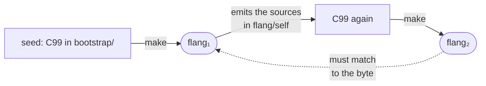

[Back to the README](../../README.md) · [Documentation index](../README.md)

# The bootstrap circle: the compiler builds itself

This page shows where the `flang` command comes from when the compiler is
written in flang itself, and how it is checked that the built compiler
understands the language the same way its sources do. By the end you can rebuild
the compiler from scratch with nothing but `cc` and `make`, run that check
yourself and read its answer. The end of the page says what it does not check.

## The problem

The flang compiler is written in flang. To build it you need a flang compiler.
The circle is closed. What breaks it is the **committed seed**: the tree carries
the same compiler emitted into C99 in advance.



One `make` turns the seed into a working compiler. Nothing else is needed for
that: no network, no other flang compiler, no language other than `cc`. The
compiler then emits itself from the flang sources. A second binary is built from
that emission, and **the second must equal the first**. What is compared is the
emitted C files, down to the last byte.

If they match, the built compiler understands the language exactly as the
sources it was built from do. If they do not, the check names the file and the
byte where they differ.

## Where the circle stands today

Two commands say how the committed seed relates to today's sources.

`sh scripts/bootstrap-reprint.sh --bystro` takes about two seconds and does not
emit anything. It names the commit the seed answers to, checks that this commit
is an ancestor of `HEAD`, and compares the seed's fingerprint with the tree:

```
семя отвечает коммиту …, и он предок HEAD:
  входов в отпечатке 90, пределы совпали, сводов с тех пор …
  тело семени сошлось с деревом: файлов 9, байт …
  входы печати с тех пор не двигались: отставание 0 файлов
```

`bootstrap/flang io scripts/seed/what-lags-the-seed.fscript --plan Report --timeout 300000`
answers the finer question: it names, file by file and function by function, what
in the sources is newer than the seed, so the binary built from the seed does not
know it.

## How to run it

```bash
make -C bootstrap -j8                    # build the compiler from the seed
sh scripts/bootstrap-reprint.sh --check  # compare the seed with what the sources emit
```

The second command re-emits the seed files and compares them with the committed
ones. A divergence is reported by file, byte and line.

The emission limits are `--max-steps 8000000000000 --max-depth 20000`. They are
set in `scripts/bootstrap-reprint.sh`; check against it, not against this page.
Those numbers go into the emitted C (`#define FL_MAX_STEPS`), which means they
take part in the equality. An emission with different limits gives different
bytes, and nothing reports it.

The limit is that large by measurement. Emission runs the same checks as
`check`, and the most expensive step is the proof kernel checking the compiler
itself. Its measured cost is kept in
`scripts/bootstrap-reprint.sh` as `MEASURED_COST` — 2 508 501 226 319 steps — and
the ceiling `MAX_STEPS` is about 3.2 times that. The price of the headroom is named
in the same place: at 23.16 million steps per second, a non-terminating program
runs for about 96 hours before it is stopped. The whole breakdown is in the header
of `scripts/bootstrap-reprint.sh`.

## What a match does not mean

Two binaries agreeing says: the compiler reads the language the same way the
compiler that emitted these sources read it. **It does not say the language is
read correctly.** A mistake written the same way into the sources and into the
seed survives the circle unnoticed: the circle compares an implementation with
itself.

What catches that kind of mistake in the tree are the frozen answer tables
(`flang/test/fixtures/`, 56 entries — `ls flang/test/fixtures | wc -l`): today's binary is run against them, and
disagreeing with a recorded answer is an error. In CI this is the step "Check
kernel forgeries" of job `storozha` in `.github/workflows/binary.yml`:
`bootstrap/flang io flang/scripts/kernel-forgeries.fscript --на-веру --plan 'Подделки остаются недоказанными'`.
That catches only a **regression**: yesterday the compiler answered this, today
it answers that. There is one
implementation of the language, and no independent reading of the same rules to
compare its answers against.

## The seed falls behind the sources without a message

The circle closing does not mean the committed seed matches today's sources. A
change to the compiler is merged and `bootstrap/` is not re-emitted. The rule
sits in `flang/self/*.flang`, and the built program does not have it. Every check
passes meanwhile: the source parses, the seed builds, and the circle closes on
whatever the seed contains. A change to the proof kernel can be lost this way
too.

Two checks catch it, and they answer different questions.

| Command | Question | Cost |
|---|---|---|
| `sh scripts/bootstrap-reprint.sh --check` | does the seed match the emission exactly, down to the last byte | a full emission: hours |
| `sh scripts/bootstrap-reprint.sh --bystro` | are the emission's inputs the same ones | about 2 s |

The expensive one re-emits. The cheap one does not emit: it compares the
contents of the files the compiler is built from, the 4 runtime files that go
into the output almost verbatim (90 inputs together), and the emission limits.
Separately it compares the 9 files of the seed itself. You can recount them on
the spot: `scripts/seed-fingerprint` has one line per file. The emission itself
writes the fingerprint; there is no separate command for it.

The cheap one runs on every push as job `semya` in
`.github/workflows/binary.yml`; a mismatch is an error, not a warning. The full
byte-for-byte comparison is run before a release and after merges.

**What the cheap one does not prove:** that the files are identical down to the
last byte. It answers the narrower question — "are these the same inputs".

## What the circle does not check

**The compiler does not check its own sources in reasonable time.** `flang check
--быстро flang/self/bootstrap/compiler.flang` does not reach an answer within a
500 s run ceiling: it is still at «Связать исходники», past 20 billion steps and
7 GiB. What the seed binary does not know is reported not by `check` but by
`bootstrap/flang io scripts/seed/what-lags-the-seed.fscript --plan Report --timeout 300000`.

**Rebuilding needs the tree, not the seed directory.** Emission reads the C
runtime sources from disk (`flang/src/emit/c/`). `bootstrap/` holds the result
of an emission, and that directory alone is not enough for the circle.

## Where a release comes from

The C in a release archive is emitted from these same sources by this same
circle. That is why installing from the archive, installing through Homebrew and
building from a clone build the compiler from the same C.
