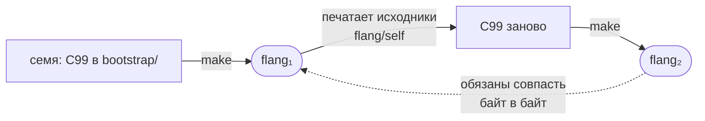

[К README](../README.ru.md) · [Указатель документации](../README.md)

# Круг раскрутки: компилятор собирает сам себя

Отсюда вы узнаете, откуда берётся команда `flang`, если компилятор написан на
самом flang, и как проверяется, что собранный компилятор понимает язык так же,
как исходники. К концу страницы вы сможете пересобрать компилятор с нуля, имея
только `cc` и `make`, запустить эту проверку и прочитать её ответ. В конце сказано,
чего она не проверяет.

## Задача

Компилятор flang написан на flang. Чтобы его собрать, нужен компилятор flang.
Круг замкнут. Разрывает его **закоммиченное семя**: в дереве лежит тот же
компилятор, заранее напечатанный в C99.



Из семени одним `make` собирается двоичный компилятор. Больше для сборки ничего
не нужно: ни интернета, ни другого компилятора flang, ни другого языка, кроме
`cc`. Дальше собранный компилятор печатает сам себя из исходников на flang. Из
этой печати собирается второй двоичный, и **второй обязан совпасть с первым**.
Совпадают напечатанные файлы C, байт в байт.

Если они совпали, собранный компилятор понимает язык так же, как исходники, из
которых он собран. Если нет, проверка называет файл и байт расхождения.

## Где круг стоит сегодня

Как закоммиченное семя относится к нынешним исходникам, говорят две команды.

`sh scripts/bootstrap-reprint.sh --bystro` идёт около двух секунд и ничего не
печатает. Она называет коммит, которому отвечает семя, проверяет, что этот коммит —
предок `HEAD`, и сверяет отпечаток семени с деревом:

```
семя отвечает коммиту …, и он предок HEAD:
  входов в отпечатке 90, пределы совпали, сводов с тех пор …
  тело семени сошлось с деревом: файлов 9, байт …
  входы печати с тех пор не двигались: отставание 0 файлов
```

`bootstrap/flang io scripts/seed/what-lags-the-seed.fscript --plan Report --timeout 300000`
отвечает подробнее: называет по файлам и по функциям, что в исходниках новее
семени, то есть чего собранный из семени двоичный не знает.

## Как это запустить

```bash
make -C bootstrap -j8                    # собрать компилятор из семени
sh scripts/bootstrap-reprint.sh --check  # сверить семя с тем, что печатают исходники
```

Вторая команда печатает файлы семени заново и сравнивает их с закоммиченными.
Расхождение она называет файлом, байтом и строкой.

Пределы печати — `--max-steps 8000000000000 --max-depth 20000`. Заданы они в
`scripts/bootstrap-reprint.sh`; сверяйтесь с ним, а не с этой страницей. Эти числа
попадают в напечатанный C (`#define FL_MAX_STEPS`), то есть участвуют в
совпадении. Печать с другими пределами даст другие байты, и сообщения об этом
не будет.

Предел такой большой по измерению. Печать запускает те же проверки, что `check`,
и самый дорогой её шаг — проверка самого компилятора ядром доказательств. Его измеренная цена хранится в `scripts/bootstrap-reprint.sh` как
`MEASURED_COST` — 2 508 501 226 319 шагов, — а потолок `MAX_STEPS` больше неё
примерно в 3,2 раза. Цена запаса названа там же: при 23,16 млн шагов в секунду
незавершающаяся программа считается до остановки около 96 часов. Весь разбор — в
шапке `scripts/bootstrap-reprint.sh`.

## Чего совпадение не значит

Совпадение двух двоичных говорит: компилятор понимает язык так же, как понимал
его тот компилятор, который эти исходники напечатал. **Оно не говорит, что язык
понят правильно.** Ошибку, одинаково записанную и в исходниках, и в семени,
круг не заметит: он сверяет реализацию саму с собой.

Такие ошибки в дереве ловят записанные ответы (`flang/test/fixtures/`, 56
записей — `ls flang/test/fixtures | wc -l`). Сегодняшний двоичный запускается на
них, и расхождение с записанным ответом — ошибка. В CI это шаг «Check kernel
forgeries» работы `storozha` в `.github/workflows/binary.yml`:
`bootstrap/flang io flang/scripts/kernel-forgeries.fscript --на-веру --plan 'Подделки остаются недоказанными'`.
Шаг ловит только **регресс**: вчера компилятор отвечал так, сегодня иначе.
Реализация языка одна, и сравнить её ответы с независимым прочтением тех же
правил не с чем.

## Семя отстаёт от исходников без сообщения

Сошедшийся круг ещё не значит, что закоммиченное семя отвечает нынешним
исходникам. Правку компилятора вливают, `bootstrap/` не перепечатывают. Правило
лежит в `flang/self/*.flang`, а в собранной программе его нет. Все проверки при
этом проходят: исходник разбирается, семя собирается, круг замыкается на том,
что лежит в семени. Так может потеряться и правка ядра доказательств.

Ловят это две сверки, и вопросы у них разные.

| Команда | Вопрос | Цена |
|---|---|---|
| `sh scripts/bootstrap-reprint.sh --check` | совпадает ли семя с печатью побайтно | полная печать: часы |
| `sh scripts/bootstrap-reprint.sh --bystro` | те ли у печати входы | около 2 с |

Дорогая сверка печатает заново. Дешёвая не печатает: она сверяет содержимое
файлов, из которых собирается компилятор, 4 файлов рантайма, попадающих в вывод
почти дословно (вместе 90 входов), и пределы печати. Отдельно она сверяет 9
файлов самого семени. Пересчитать можно на месте: в `scripts/seed-fingerprint`
по строке на файл. Отпечаток записывает сама печать, отдельной команды для
этого нет.

Дешёвая сверка запускается на каждый пуш работой `semya` в
`.github/workflows/binary.yml`; расхождение — ошибка, а не предупреждение.
Полную сверку байт в байт запускают перед выпуском и после слияний.

**Чего дешёвая не доказывает:** что файлы совпадают байт в байт. Она отвечает на более
узкий вопрос — «те ли входы».

## Что круг не проверяет

**Компилятор не проверяет собственные исходники за разумное время.** `flang check
--быстро flang/self/bootstrap/compiler.flang` за потолок прогона 500 с до ответа
не доходит: всё ещё «Связать исходники», больше 20 млрд шагов и 7 ГиБ. Чего
двоичный из семени не знает, говорит не `check`, а
`bootstrap/flang io scripts/seed/what-lags-the-seed.fscript --plan Report --timeout 300000`.

**Пересборке нужно дерево, а не каталог семени.** Печать читает исходники
рантайма C с диска (`flang/src/emit/c/`). В `bootstrap/` лежит уже результат
печати, и одного этого каталога для круга недостаточно.

## Откуда берётся выпуск

C в архиве выпуска напечатан из этих же исходников тем же кругом. Поэтому
установка из архива, установка через Homebrew и сборка из клона собирают
компилятор из одного и того же C.
