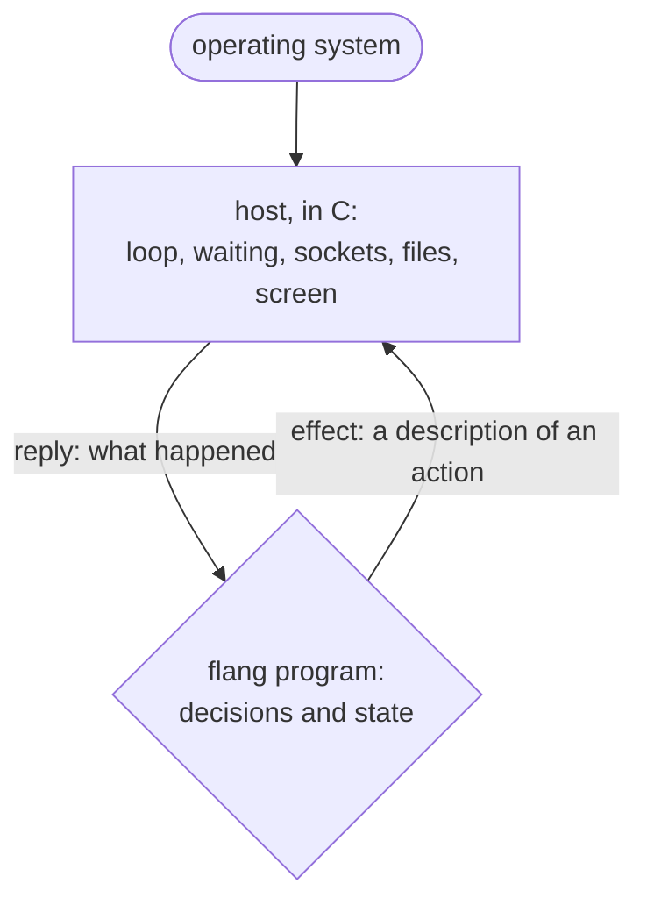

# The boundary between flang and the host

What a flang program can ask of the outside world, and what it cannot. The page
answers with two tables and two examples you can run.

Two terms. The **host** is a program in another language, usually C, that waits
for events and performs actions: it reads files, opens sockets, writes registers.
An **effect** is a description of one such action. A flang function returns an
effect as an ordinary value, and the host performs it.



A flang function waits for nothing and changes nothing. It takes a state and an
event and returns a new state and an effect. That is why you can test it with
examples that need no files or network, and prove its postconditions.

## Example: write a file

File `docs/examples/host-boundary/note.flang`:

```flang insert docs/examples/host-boundary/note.flang
модуль «Note»

тип «Шаг заметки»
  вариант «Пишем»
  вариант «Ждём запись»

план «Заметка»
  состояние «Шаг заметки»
  начинает с «Начало заметки»
  обрабатывает «Дальше»

тотальная функция «Начало заметки»
  возвращает «Шаг заметки»
  вариант «Пишем»

тотальная функция «Записать заметку»
  возвращает «Поручение»
  вариант «Записать файл» с путь равным "note.txt" и содержимое равным "привет\n"

тотальная функция «Дальше»
  принимает шаг: «Шаг заметки», отклик: «Отклик»
  возвращает «Продолжение»
  пример «ошибка хоста становится ошибкой плана»
    дано шаг равно вариант «Ждём запись»
    дано отклик равно вариант «Сбой» с код равным "FLANG_IO_DENIED" и сообщение равным "запись запрещена"
    ожидается вариант «Провал» с код равным "FLANG_IO_DENIED" и сообщение равным "запись запрещена"
  разбор отклик
    случай вариант «Пока ничего»
      то вариант «Сделать» с поручение равным «Записать заметку» и потом равным (вариант «Ждём запись»)
    случай вариант «Записано»
      то вариант «Конец работы» с значение равным "записано"
    случай вариант «Сбой» с код как код и сообщение как сообщение
      то вариант «Провал» с код равным код и сообщение равным сообщение
    случай любое
      то вариант «Провал» с код равным "FLANG_IO_ORDER" и сообщение равным "ждали ответа на запись"
```

`план` (plan) declares a program with effects: the state type, the starting
function and the handler function. The types `«Поручение»` (an effect),
`«Отклик»` (the host's reply) and `«Продолжение»` (what to do next) are built
into the language. The command `flang io` acts as the host:

```text
$ flang io docs/examples/host-boundary/note.flang
доказано: утверждений 0
{"plan":"Заметка","result":"записано","orders":1,"log":[{"поручение":{"variant":"Записать файл",
"fields":{"путь":"note.txt","содержимое":"привет\n"}},"отклик":{"variant":"Записано","fields":{"сколько":7}}}]}
```

The line «доказано: утверждений 0» says the file has no unproved postconditions.
After it comes the answer in JSON: `result` is the outcome of the plan, `orders` is the number of
effects performed, `log` is the journal. The journal holds one pair: the effect
«Записать файл» (write a file, key `поручение`) and the host's reply «Записано»
(written), 7 bytes (key `отклик`). The file `note.txt` appears next to
`note.flang`: a relative path is resolved from the program's directory.

`flang io` does not run a plan with unproved postconditions unless you pass
`--trust`.

## What a program can ask for

There are 28 effects, and the list is closed: a program cannot add its own. The
host can forbid each group with a `flang io` flag.

| Group | Effects (variant names of the type `«Поручение»`) | Forbidden by |
| --- | --- | --- |
| reading files | `Прочитать файл`, `Прочитать октеты из файла`, `Перечислить каталог` | `--no-read` |
| writing files | `Записать файл`, `Записать октеты в файл`, `Удалить файл`, `Завести временный каталог` | `--no-write` |
| network | `Запросить` (HTTP and HTTPS), `Открыть соединение`, `Принять соединение`, `Прочитать из соединения`, `Ответить в соединение`, `Прочитать октеты из соединения`, `Ответить октетами в соединение`, `Отправить датаграмму`, `Принять датаграмму` | `--no-net` |
| processes | `Запустить процесс`, `Запустить процесс с вводом`, `Запустить процесс с пределом` | `--no-spawn` |
| time | `Текущее время` | `--no-clock` |
| random numbers | `Случайное число`, `Случайные октеты` | `--no-random` |
| environment variables | `Прочитать переменную среды` | `--no-env` |
| command-line arguments | `Прочитать доводы` | `--no-args` |
| screen and keyboard | `Показать`, `Показать страницу`, `Ждать событие`, `Размер экрана` | `--no-screen` |

A forbidden effect is not performed, and the plan stops with the error
`FLANG_IO_DENIED`:

```text
$ flang io docs/examples/host-boundary/note.flang --no-write
доказано: утверждений 0
{"error":"хозяину запрещено писать файлы","diagnostics":[{"code":"FLANG_IO_DENIED",
"message":"хозяину запрещено писать файлы","severity":"error","span":{"line":7,"column":1}}]}
```

The line with `FLANG_IO_DENIED` is the error: the host (called «хозяин» in the
message) is not allowed to write files. The exit
code is 1. An effect that fails without a flag reaches the handler as the
variant `«Сбой»` (failure): the language has no exceptions.

## What a program cannot do

| Cannot | Why | Who does it |
| --- | --- | --- |
| wait: `accept`, `poll`, reading a socket, an incoming interrupt | the language has no action that blocks | the host waits and passes the result as an argument |
| hold an event loop | a function returns a value and ends | the loop is written in the host |
| touch an address, a register, device memory | there are no pointers and no manual allocation | the function returns a list of register writes, the host writes them |
| embed assembly | the language has no such form | the host |
| call a foreign library function or a system call | the list of effects is closed | the host |
| change a value in place | values are immutable | the host or the `план` keeps the state between calls |

The table also answers the question about operating systems. A whole operating
system cannot be written in flang: the interrupt handler, the context switch
and the waiting loop stay in C. The deciding part can: parsing packets and
formats, permission checks, protocol states, scheduling policy, a driver's
state machine.

> **What flang does not guarantee here.** The compiler is not proved as a whole,
> the way CompCert is. The proofs are about the flang program. The generated C
> can be compared with a reference, function by function. The C runtime, the C
> compiler and libc are taken without proof. Details:
> [Known limits](limits.html).

## Example: your own host in C

The second way to join the two sides is to generate C and write the host by
hand. The directory `docs/examples/host-boundary/`:

| File | What is in it |
| --- | --- |
| `gatekeeper.flang` | the decision: whom to let through, whom to refuse and with which code; eight functions |
| `host.c` | the host: the loop, reading standard input, mutable state |
| `run.sh` | generates C, builds and runs, in one command |

The host reads a line, builds an event and calls one function of the module:

```c
for (;;) {
  if (fgets(line, sizeof line, stdin) == NULL) break;  /* no more events */
  ...
  gatekeeper_enter(&ctx, "Шаг привратника", args, 2, &decision, &error);
  ...
}
```

The loop is in C because of the line with `fgets`: it waits for input.

The generated header gives two call functions. Pass values that come from
outside through `gatekeeper_enter`:

```c
/* argument types are not checked */
fl_status gatekeeper_call (fl_ctx *ctx, const char *name, ...);
/* declared types and preconditions are checked before the call */
fl_status gatekeeper_enter(fl_ctx *ctx, const char *name, ...);
```

The termination proof rests on the argument type. A value outside the type
voids that proof, so input from outside is checked.

First check the decision:

```text
$ flang test docs/examples/host-boundary/gatekeeper.flang
docs/examples/host-boundary/gatekeeper.flang: примеров 15, прошло 15, не прошло 0
$ flang check docs/examples/host-boundary/gatekeeper.flang --proof
…
docs/examples/host-boundary/gatekeeper.flang: НЕ ДОКАЗАНО — ОПОРА НЕ СУДИЛАСЬ — утверждений 31: доказано 25, условно 0, сетка 6, … — код возврата 3
```

All 15 examples pass. Of 31 postconditions, 25 are proved for every input and 6
are only tested on examples (the word «сетка» in the output). So
`check --proof` returns exit code 3.

Then build and run:

```text
$ flang emit docs/examples/host-boundary/gatekeeper.flang --target c --no-cli --out out
$ cc -std=c99 -Wall -Wextra -O2 -I out -o host docs/examples/host-boundary/host.c out/gatekeeper.c out/flang_runtime.c -lm -lpthread
$ printf 'запрос 1\nтакт\nтакт\nтакт\nзапрос 1\nзапрос 5\n' | ./host
хозяин: врата открыты. ёмкость 3, уровень ключа 2, запас 0
хозяин: жду событий на стандартном вводе: «такт» или «запрос N»
запрос 1 → код 429, ОТКАЗАНО, запас 0, пропущено 0, отказано 1
такт     → запас 1 из 3
такт     → запас 2 из 3
такт     → запас 3 из 3
запрос 1 → код 200, пропущен, запас 2, пропущено 1, отказано 1
запрос 5 → код 403, ОТКАЗАНО, запас 2, пропущено 1, отказано 2
хозяин: событий 6, пропущено 1, отказано 2
хозяин: нарочно порчу довод — запас 4 при ёмкости 3
граница отвергла довод: FLANG_PRECONDITION — не выполнено требование «запас не выше ёмкости» функции «Шаг привратника»
```

The word «хозяин» in the output is the host. It writes the first two lines at
start. Then one line per event: the first request (`запрос`) is refused with
code 429 because the reserve (`запас`) is empty. Three tick events (`такт`)
refill the reserve to 3. The next request passes with code 200. The request of
level 5 is refused with code 403: not enough rights. The ninth line shows the
host's counters.

In the last two lines the host passes a wrong argument on purpose: a reserve of
4 with a capacity of 3. `gatekeeper_enter` checks the precondition and returns
the error `FLANG_PRECONDITION`. The program does not crash; the exit code is 0.

The flag `--no-cli` leaves the function `main` out of the generated code: it is
in `host.c`. The host frees the memory a call used on every turn of the loop
with one call to `fl_arena_reset`.

## Next

* [Known limits](limits.html)
* [Processes, supervision, distribution](processes.html)
* [The MSI driver](msi-driver.html)
