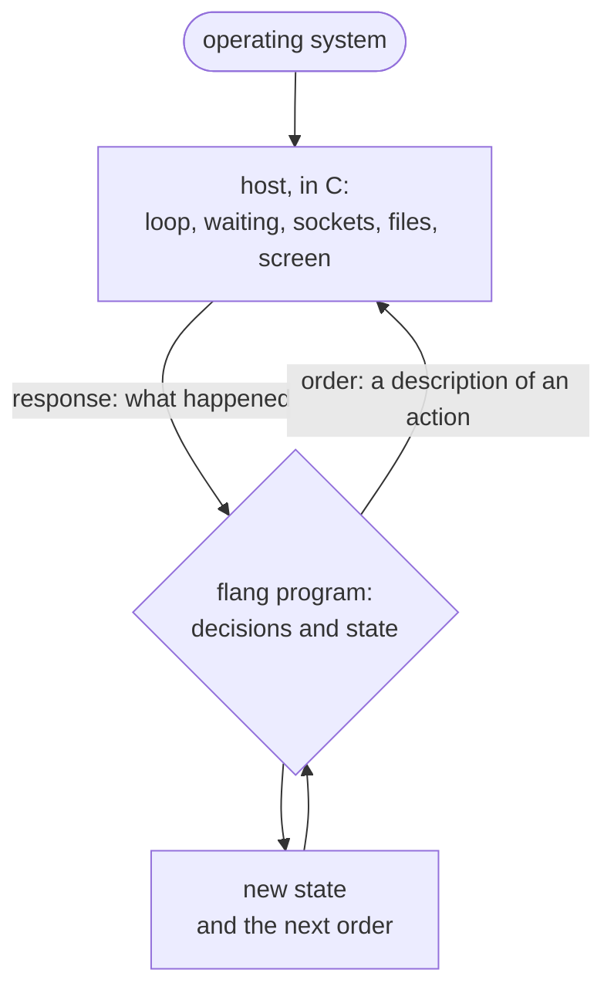

# Where flang ends and the host begins

The language has no interrupts and no inline assembly, and a service loop cannot
be written in it. This page names exactly which layer of a system you can write
in flang, which one you cannot, and how the two layers talk.

The short answer:

> **flang is written for what DECIDES. What WAITS — and what holds control
> between two decisions — belongs to the host.**



"Host" here means a program in another language that takes events from the world
and carries out the answer — usually C.

## What the line does NOT mean

The familiar explanation — "flang is for what terminates" — is wrong, and
wrong in a way you can check.

**The language does not forbid an infinite loop.** The mark `тотальная` is a
promise, and the compiler checks exactly that promise. A function without the
mark promises nothing and may have no stopping condition at all — and it passes
the check:

```
$ cat вечный.flang
модуль «Вечный цикл»

функция «Крутить»
  принимает н: число
  возвращает число
  «Крутить» от (н плюс 1)

$ flang check вечный.flang; echo $?
модуль «Вечный цикл»: функций 1, из них с доказанным завершением 0; типов 0
без доказанного завершения: «Крутить»
вечный.flang: проверено — разбор, типы, завершаемость, ядро и примеры; замечаний нет
0
```

Non-termination does not turn into a hang either:
both the evaluator and the printed program count steps and turn exhaustion into
a named refusal, `FLANG_RECURSION_LIMIT`. So what the language forbids is not
the infinite loop but **lying about termination**.

**A scheduler in flang exists.** It is in `flang/concurrency/scheduler.flang`, and termination
is proved for every one of its functions. Take the waiting and the call of a handler by name out
of a scheduler, and what remains is decisions.

## What cannot be written in flang

Four things, and not one of them is about the length of a loop.

**1. Waiting.** `accept`, `connect`, reading a socket, `poll`, reading the
clock, an interrupt arriving. The language has no word at all for this: the host
waits, and the program receives the result of the wait as an argument.

**2. Control between two decisions.** Between two actions, control must leave
the language. It cannot pass a function to a place where the function arrives as
data, and a program cannot call the host by name — it has no access to the
world. So the loop belongs to the host.

**3. Hardware.** Addresses, registers, memory-mapped device space, the interrupt
vector table. The language has no pointers and no manual allocation, and both
the termination proof and the region-based memory work rest on their absence.

**4. Inline assembly.** The form does not exist in the language, and adding it
would be pointless by construction: the proof kernel reads expressions of the
language and has nothing to say about an inline block. One such block would void
every promise of the function it sits in.

## What can be written in flang

Everything that turns input into output and waits for nothing. Already written:

| what | where | functions | of them marked `тотальная` |
| --- | --- | ---: | ---: |
| HTTP parsing and printing | `flang/stdlib/http.flang` | 64 | 64 |
| the AES cipher | `flang/stdlib/aes.flang` | 105 | 105 |
| talking to PostgreSQL | `flang/stdlib/postgres.flang` | 67 | 67 |
| the SHA-256 hash | `flang/stdlib/sha256.flang` | 37 | 37 |
| base64 | `flang/stdlib/base64.flang` | 19 | 19 |
| scheduler decisions | `flang/concurrency/scheduler.flang` | 54 | 54 |

The count is of function headers in the file (`grep -c '^функция «\|^тотальная функция «'`). For the scheduler the compiler
says the same, counting the imported module as well:

```
$ flang check flang/concurrency/scheduler.flang; echo $?
модуль «Планировщик узла»: функций 73, из них с доказанным завершением 73; типов 17; файлов вместе с импортами 2
0
```

Packet parsing, codecs, protocol states, permission checks — and scheduler
decisions in the same row.

## What follows for an operating system

An operating system kernel still cannot be rewritten in flang, but the reason is
a different one, and the difference is not verbal:

> **Waiting** cannot be written in flang. Somebody still has to wait for the
> interrupt, and that somebody is not a flang program.

Hence the honest inventory of what in a system **can** be written in flang:
packet parsing, format parsing, permission checks, protocol states, scheduling
policy — the deciding half. And of what **cannot**: the interrupt handler in the
sense of "what the processor runs off the vector", waiting for a device to be
ready, context switching, the loop itself.

A second, independent obstacle: the host must itself be a program under an
operating system — it calls `open`, `read`, `write`, `fork`. In such a system
flang would sit above the kernel rather than be it.

## The interrupt handler is the subtler case, and the instructive one

An interrupt handler does terminate, and still cannot be written in flang as a
whole — because the other half of its job is waiting and hardware. But the first
half can be, and that is not a small thing.

The tree carries this as a separate example, `docs/examples/driver/uart.flang`. The
driver there is a pure function: "state and event → new state and a list of
register writes". It writes nothing; it **answers what to write**. The host does
the writing, and its whole job is a six-line loop. The state machine, meanwhile,
is proved in full.

Hence the rule that is worth more than any of the particular ones: **measure
lines, not files**. "This touches the world, so it cannot be written in flang" is
almost always said about a file in which the world and the decisions about the
world lie mixed together, and the proportion can be anything at all.

## How the two layers talk

There are two ways, and both are written down as data rather than as convention.

**First: the dictionary of orders.** A program does not perform an action — it
returns a **description of the action**, a variant of the sum type «Поручение».
The host performs it and returns an «Отклик», also a variant; a failure arrives
as a variant, not as an exception, because the language has no exceptions. There
are twenty order variants, and the set is deliberately closed: a function from a
foreign library cannot be called, neither through a shared object nor through a
system call.

A program with orders declares a `план`: a state, a starting function and a handler of
responses. The command `flang io` runs the plan:

```flang
модуль «Note»

тип «Ход»
  вариант «Пишем»
  вариант «Ждём запись»

план «Заметка»
  состояние «Ход»
  начинает с «Начало»
  обрабатывает «Дальше»

тотальная функция «Начало»
  возвращает «Ход»
  вариант «Пишем»

тотальная функция «Записать»
  возвращает «Поручение»
  вариант «Записать файл» с путь равным "note.txt" и содержимое равным "привет\n"

тотальная функция «Дальше»
  принимает ход: «Ход», отклик: «Отклик»
  возвращает «Продолжение»
  пример «отказ хозяина становится отказом плана»
    дано ход равно вариант «Ждём запись»
    дано отклик равно вариант «Сбой» с код равным "FLANG_IO_DENIED" и сообщение равным "запись запрещена"
    ожидается вариант «Провал» с код равным "FLANG_IO_DENIED" и сообщение равным "запись запрещена"
  разбор отклик
    случай вариант «Пока ничего»
      то вариант «Сделать» с поручение равным «Записать» и потом равным (вариант «Ждём запись»)
    случай вариант «Записано»
      то вариант «Конец работы» с значение равным "записано"
    случай вариант «Сбой» с код как код и сообщение как сообщение
      то вариант «Провал» с код равным код и сообщение равным сообщение
    случай любое
      то вариант «Провал» с код равным "FLANG_IO_ORDER" и сообщение равным "ждали ответа на запись"
```

```
$ flang io note.flang
доказано: утверждений 0
{"plan":"Заметка","result":"записано","orders":1,"log":[{"поручение":{"variant":"Записать файл",
"fields":{"путь":"note.txt","содержимое":"привет\n"}},"отклик":{"variant":"Записано","fields":{"сколько":7}}}]}
$ cat note.txt
привет
```

The answer is JSON: the plan's result, the number of orders and the log of order and response.
A plan with unproved promises is not run by `flang io` until `--trust` is given.

A program that goes to the network is proved to terminate, because the network is not inside it.
What terminates is the description; what waits is the host.

Authority stays with the host. There are nine prohibitions: `--no-read`, `--no-write`,
`--no-net`, `--no-clock`, `--no-random`, `--no-spawn`, `--no-env`, `--no-args`, `--no-screen`.
A forbidden order is not carried out, and the run ends with the refusal `FLANG_IO_DENIED`:

```
$ flang io note.flang --no-write
доказано: утверждений 0
{"error":"хозяину запрещено писать файлы","diagnostics":[{"code":"FLANG_IO_DENIED",
"message":"хозяину запрещено писать файлы","severity":"error","span":{"line":7,"column":1}}]}
```

**Second: printing to a target language plus a hand-written host.** The program
is printed into C (or one of the ten print targets), and the host is written by
hand: it holds the loop, waits for events and calls the printed function. That
is the example on this page.

Processes have the same shape: the plan, the handlers and the supervision rules
are in flang; the loop, the operating system threads and the network wait are in
C. This is the largest live example of the boundary in the tree, and by lines it
looks like this:

| what | where | lines |
| --- | --- | ---: |
| scheduler: loop, threads, network wait | `flang/src/emit/c/flang_conc.c` | 4954 |
| decisions about processes, supervision, links | `flang/concurrency/*.flang` | 2507 |

Line counts by `wc -l`. The first file has six loops
with no exit condition (`for (;;)`), the second has none — and not because they
are forbidden. Without waiting such a loop has nothing to do,
and there is nothing in the language to wait with.

## The door: one function, and types are checked before the call

Printing to C puts two doors next to the code. The difference between them is not
a matter of style.

```c
/* computation: argument types are NOT checked */
fl_status gatekeeper_call (fl_ctx *ctx, const char *name, ...);
/* entry boundary: declared types are checked BEFORE the call */
fl_status gatekeeper_enter(fl_ctx *ctx, const char *name, ...);
```

Values that came from outside — from a person, from the network, from another
language — must come in through `enter`. The printed header states the reason
itself: the termination proof rests **on the type**, and a value outside its type
carries the proof away along with the type.

Preconditions live on that same boundary. The line `требует «имя» условие` is a
contract with the caller; a check for it is printed into the generated code only
where the value arrives from outside. Internal calls do not pay for it.

## An example that actually runs

`docs/examples/host-boundary/` is the whole junction, three files:

| file | what it is |
|---|---|
| `docs/examples/host-boundary/gatekeeper.flang` | the decision: who gets through, who is refused, with which code. Module «Gatekeeper» |
| `docs/examples/host-boundary/host.c` | the execution: the loop, input-output, mutable state |
| `docs/examples/host-boundary/run.sh` | the run script; it fails in 0.7.34, the commands below replace it |

The decisions — parsing the request, checking rights, the budget and its
refill, the state transition, the response codes — are all on this side of the
line. The host builds a value, calls one function and carries out what it
returned.

On the flang side there are eight functions, all total. Not one of them does
anything — each returns a value:

```flang
тотальная функция «Шаг привратника»
  принимает врата: «Врата», событие: «Событие»
  возвращает «Решение»
  требует «запас не выше ёмкости» врата.«запас» не больше врата.«ёмкость»
  обеспечивает «ГЛАВНОЕ: из годных врат выходят годные» результат.«врата».«запас» не больше результат.«врата».«ёмкость»
  обеспечивает «ёмкость шагом не меняется» результат.«врата».«ёмкость» равен врата.«ёмкость»
```

On the C side is what flang cannot write:

```c
for (;;) {
  if (fgets(line, sizeof line, stdin) == NULL) break;  /* the world says there are no more events */
  ...
  gatekeeper_enter(&ctx, "Шаг привратника", args, 2, &decision, &error);
  ...
}
```

This loop is in C not because it is infinite — the language accepts non-total
functions. It is in C because of one line inside it: `fgets` **waits**.

The decision is checked with the usual commands:

```
$ flang test docs/examples/host-boundary/gatekeeper.flang
docs/examples/host-boundary/gatekeeper.flang: примеров 15, прошло 15, не прошло 0
$ flang check docs/examples/host-boundary/gatekeeper.flang --proof
…
утверждений 31: доказано 25, условно 0, сетка 6, объявлено, не доказано 0, отвергнуто 0, нарушено 0
```

All eight functions are total. Of 31 postconditions, 25 are proved for all inputs and 6 are only
computed on examples — among them «ГЛАВНОЕ: из годных врат выходят годные». That is why
`check --proof` returns code 3. Proved postconditions do not travel into the printed code as
checks («проверок при работе снято 25»).

To build and run the seam: the host and `run.sh` are written for the names `privratnik_*`, while
printing module «Gatekeeper» gives `gatekeeper_*`, so the names are replaced in a copy of the
host:

```
$ flang emit docs/examples/host-boundary/gatekeeper.flang --target c --no-cli --out out
$ sed 's/privratnik/gatekeeper/g' docs/examples/host-boundary/host.c > host.c
$ cc -std=c99 -Wall -Wextra -O2 -I out -o host host.c out/gatekeeper.c out/flang_runtime.c -lm -lpthread
$ printf 'запрос 1\nтакт\nтакт\nтакт\nтакт\nзапрос 1\nзапрос 5\nзапрос 1\nзапрос 1\n' | ./host
хозяин: врата открыты. ёмкость 3, уровень ключа 2, запас 0
хозяин: жду событий на стандартном вводе: «такт» или «запрос N»
запрос 1 → код 429, ОТКАЗАНО, запас 0, пропущено 0, отказано 1
такт     → запас 1 из 3
такт     → запас 2 из 3
такт     → запас 3 из 3
такт     → запас 3 из 3
запрос 1 → код 200, пропущен, запас 2, пропущено 1, отказано 1
запрос 5 → код 403, ОТКАЗАНО, запас 2, пропущено 1, отказано 2
запрос 1 → код 200, пропущен, запас 1, пропущено 2, отказано 2
запрос 1 → код 200, пропущен, запас 0, пропущено 3, отказано 2
хозяин: событий 9, пропущено 3, отказано 2
хозяин: нарочно порчу довод — запас 4 при ёмкости 3
граница отвергла довод: FLANG_PRECONDITION — не выполнено требование «запас не выше ёмкости» функции «Шаг привратника»
```

Exit code 0. Every outcome is visible: refusal on an exhausted budget (429),
the budget filling up on ticks, the capacity ceiling, a pass (200), refusal on
insufficient rights (403). On the last line the host DELIBERATELY passes a
broken argument — a budget above the capacity — and the boundary precondition
turns it away. The refusal arrives as a status, not as a crash: the host loop
goes on.

Three details of the junction that are visible only in the sources:

* printing is invoked with the flag `--no-cli`: the program has its own entry
  point, in `docs/examples/host-boundary/host.c`, and two `main` functions in one
  build do not link;
* the printed module's memory lives in an arena, and the host returns it on
  every iteration with one call to `fl_arena_reset` — everything flang built has
  by then been copied into the host's state;
* the precondition `требует «запас не выше ёмкости»` stands on «Шаг привратника»
  — the function the host calls. It cannot be kept on the internal «Пропуск
  врат»: the call from «Запрос к вратам» does not discharge the precondition,
  and the compiler answers `FLANG_PRECONDITION_CALL`. The rule: `требует` goes
  on the boundary function; internal ones make do with promises.

Next to it in the tree sits a second junction, made the first way — through the
dictionary of orders: `docs/examples/io/packet-filter.flang` parses an IPv4
datagram header together with the TCP destination port and decides whether to
let it through. Seventeen functions, all total; the octets leave for the
operating system and come back through `write` and `read`. The same line on
other tasks: `docs/examples/driver/` — on hardware (the [MSI
driver](msi-driver.html)), `docs/examples/web/orders-api.flang` — on a REST service,
`docs/examples/io/link-report.flang` — on input-output.

## What this does not solve

**There is no liveness here.** It is proved that every step carries the system
from a sound state to a sound state. It is not proved that the system will ever
wake up for the next event: that is a property of an infinite sequence rather
than of one step, and it lives with the host.

**A foreign function cannot be called.** Not through a shared library, not
through a system call. Exactly one path leads outward — the dictionary of
input-output orders — and it is closed on purpose.

**The language has no pointers and no manual freeing,** and that is not going to
change: the termination proof rests on their absence.

## Next

* [What the mark «тотальная» buys you](totality.html)
* [Processes, supervision, distribution](processes.html)
* [What is proved and what is not](what-is-proved.html)
