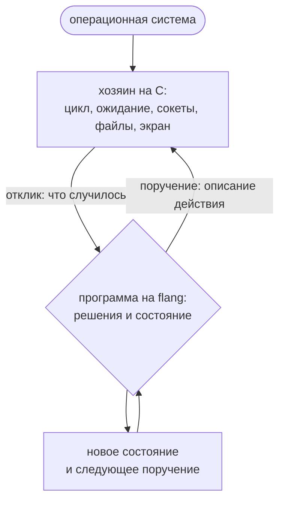

# Где кончается flang и начинается хозяин

Ни прерываний, ни ассемблерных вставок в языке нет, а цикл службы на flang не
пишется. Эта страница называет поимённо, какой слой системы писать можно, какой
нельзя, и как эти два слоя разговаривают.

Короткий ответ:

> **На flang пишется то, что РЕШАЕТ. Хозяину остаётся то, что ЖДЁТ и что держит
> управление между двумя решениями.**



Слово «хозяин» здесь значит программу на другом языке, которая принимает
события мира и исполняет ответ, — обычно это C.

## Чего граница НЕ означает

Привычное объяснение — «на flang пишется то, что завершается» — неверно, и
неверно проверяемо.

**Язык не запрещает бесконечный цикл.** Пометка `тотальная` — обещание, и
компилятор проверяет именно его. Функция без пометки никакого обещания не даёт,
условия остановки у неё может не быть вовсе — и проверку она проходит:

```
$ cat вечный.flang
модуль «Вечный цикл»

функция «Крутить»
  принимает н: число
  возвращает число
  «Крутить» от (н плюс 1)

$ flang check вечный.flang; echo $?
модуль «Вечный цикл»: функций 1, из них с доказанным завершением 0; типов 0
без доказанного завершения: «Крутить»
вечный.flang: проверено — разбор, типы, завершаемость, ядро и примеры; замечаний нет
0
```

Незавершение при этом не превращается в зависание: и вычислитель, и напечатанная
программа считают шаги и переводят исчерпание в названный отказ
`FLANG_RECURSION_LIMIT`. То есть язык запрещает не бесконечный цикл, а **ложь о
завершении**.

**Планировщик на flang написан.** Он лежит в `flang/concurrency/scheduler.flang`, и
завершение доказано у всех его функций. Уберите из планировщика ожидание и вызов обработчика
по имени — останутся решения.

## Что на flang не пишется

Четыре вещи, и ни одна из них не про длину цикла.

**1. Ожидание.** `accept`, `connect`, чтение сокета, `poll`, чтение часов,
приход прерывания. У языка нет ни одного слова, которым это выражается: ждёт
хозяин, а программа получает результат ожидания доводом.

**2. Управление между двумя решениями.** Между двумя действиями управление
обязано выйти наружу. Передать функцию туда, где она приезжает данными, язык не
умеет, а звать хозяина по имени программа не может — доступа к миру у неё нет.
Поэтому цикл принадлежит хозяину.

**3. Железо.** Адреса, регистры, отображённая память устройства, таблица
векторов прерываний. В языке нет ни указателей, ни ручного выделения памяти, и
на их отсутствии стоит и доказательство завершаемости, и работа с памятью
областями.

**4. Ассемблерная вставка.** Такой формы в языке нет вовсе, и заводить её
бессмысленно по устройству: ядро доказательств читает выражения языка, а про
вставку сказать ему нечего. Одна вставка обнулила бы смысл всех обещаний
функции, в которой стоит.

## Что на flang пишется

Всё, что превращает вход в вывод и ничего не ждёт. Уже написано:

| что | где | функций | из них с пометкой `тотальная` |
| --- | --- | ---: | ---: |
| разбор и печать HTTP | `flang/stdlib/http.flang` | 64 | 64 |
| шифр AES | `flang/stdlib/aes.flang` | 105 | 105 |
| разговор с PostgreSQL | `flang/stdlib/postgres.flang` | 67 | 67 |
| хеш SHA-256 | `flang/stdlib/sha256.flang` | 37 | 37 |
| перевод base64 | `flang/stdlib/base64.flang` | 19 | 19 |
| решения планировщика | `flang/concurrency/scheduler.flang` | 54 | 54 |

Счёт — по заголовкам функций в файле (`grep -c '^функция «\|^тотальная функция «'`). У планировщика то же самое сказал и
сам компилятор, вместе с ввезённым модулем:

```
$ flang check flang/concurrency/scheduler.flang; echo $?
модуль «Планировщик узла»: функций 73, из них с доказанным завершением 73; типов 17; файлов вместе с импортами 2
0
```

Разбор пакетов, кодеки, состояния протоколов, проверка прав — и решения
планировщика в том же ряду.

## Что из этого следует про операционную систему

Переписать ядро операционной системы на flang по-прежнему нельзя, но довод
другой, и разница не словесная:

> На flang нельзя написать **ожидание**. Кто-то всё равно должен дождаться
> прерывания, и этот кто-то — не программа на flang.

Отсюда честная опись того, что в системе на flang написать **можно**: разбор
пакетов, разбор форматов, проверка прав, состояния протоколов, политика
планирования — решающая половина. И того, что **нельзя**: обработчик прерывания
в смысле «что исполнит процессор по вектору», ожидание готовности устройства,
переключение контекста, сам цикл.

Вторым, независимым препятствием стоит то, что хозяин сам обязан быть
программой под операционной системой: он зовёт `open`, `read`, `write`, `fork`.
То есть в такой системе flang стоял бы над ядром, а не был бы им.

## Обработчик прерывания — случай тоньше, и он показателен

Обработчик прерывания завершается, и всё же целиком на flang не пишется —
потому что вторая половина его работы это ожидание и железо. Зато первая
половина пишется, и это не мелочь.

В дереве есть отдельный пример, `docs/examples/driver/uart.flang`. Драйвер там —
чистая функция «состояние и событие → новое состояние и список записей в
регистры». Она ничего не пишет: она **отвечает, что записать**. Записывает
хозяин, и вся его работа — цикл на шесть строк. Автомат при этом доказан
целиком.

Отсюда правило, которое дороже всех частных: **меряйте не файл, а строки.**
«Это трогает мир, значит на flang не пишется» почти всегда сказано о файле, в
котором мир и решения о мире лежат вперемешку, и пропорция бывает какая угодно.

## Как слои разговаривают

Способов два, и оба записаны данными, а не соглашением.

**Первый: словарь поручений.** Программа не выполняет действие — она возвращает
**описание действия**, вариант суммы «Поручение». Хозяин исполняет и возвращает
«Отклик» — тоже вариант суммы; отказ приезжает вариантом, а не исключением,
исключений в языке нет. Вариантов поручения 27, и набор закрыт намеренно:
<!-- СНЯТО 2026-10-12 список flang/self/parser.flang:6543 = 27 -->
позвать функцию из чужой библиотеки нельзя ни через разделяемый объект, ни
системным вызовом.

Программа с поручениями объявляет `план`: состояние, начальную функцию и обработчик
откликов. Исполняет план команда `flang io`:

```flang
модуль «Note»

тип «Ход»
  вариант «Пишем»
  вариант «Ждём запись»

план «Заметка»
  состояние «Ход»
  начинает с «Начало»
  обрабатывает «Дальше»

тотальная функция «Начало»
  возвращает «Ход»
  вариант «Пишем»

тотальная функция «Записать»
  возвращает «Поручение»
  вариант «Записать файл» с путь равным "note.txt" и содержимое равным "привет\n"

тотальная функция «Дальше»
  принимает ход: «Ход», отклик: «Отклик»
  возвращает «Продолжение»
  пример «отказ хозяина становится отказом плана»
    дано ход равно вариант «Ждём запись»
    дано отклик равно вариант «Сбой» с код равным "FLANG_IO_DENIED" и сообщение равным "запись запрещена"
    ожидается вариант «Провал» с код равным "FLANG_IO_DENIED" и сообщение равным "запись запрещена"
  разбор отклик
    случай вариант «Пока ничего»
      то вариант «Сделать» с поручение равным «Записать» и потом равным (вариант «Ждём запись»)
    случай вариант «Записано»
      то вариант «Конец работы» с значение равным "записано"
    случай вариант «Сбой» с код как код и сообщение как сообщение
      то вариант «Провал» с код равным код и сообщение равным сообщение
    случай любое
      то вариант «Провал» с код равным "FLANG_IO_ORDER" и сообщение равным "ждали ответа на запись"
```

```
$ flang io note.flang
доказано: утверждений 0
{"plan":"Заметка","result":"записано","orders":1,"log":[{"поручение":{"variant":"Записать файл",
"fields":{"путь":"note.txt","содержимое":"привет\n"}},"отклик":{"variant":"Записано","fields":{"сколько":7}}}]}
$ cat note.txt
привет
```

Ответ — JSON: итог плана, число поручений и журнал «поручение — отклик». План, в котором есть
недоказанные обещания, `flang io` не исполняет, пока не дан ключ `--trust`.

Программа, ходящая в сеть, доказано завершается — потому что сеть в неё не входит. Завершается
описание; ждёт хозяин.

Полномочия остаются у хозяина. Запретов девять: `--no-read`, `--no-write`, `--no-net`,
`--no-clock`, `--no-random`, `--no-spawn`, `--no-env`, `--no-args`, `--no-screen`. Запрещённое
поручение не исполняется, прогон кончается отказом `FLANG_IO_DENIED`:

```
$ flang io note.flang --no-write
доказано: утверждений 0
{"error":"хозяину запрещено писать файлы","diagnostics":[{"code":"FLANG_IO_DENIED",
"message":"хозяину запрещено писать файлы","severity":"error","span":{"line":7,"column":1}}]}
```

**Второй: печать в целевой язык и рукописный хозяин.** Программа печатается в
C (или в одну из десяти целей печати), а хозяин пишется руками: он держит
цикл, ждёт события и зовёт напечатанную функцию. Так сделан пример на этой
странице.

Та же форма — у процессов: план, обработчики и правила надзора написаны на
flang; цикл, потоки операционной системы и ожидание сети — на C. Это самый
крупный живой пример границы в дереве, и по строкам он выглядит так:

| что | где | строк |
| --- | --- | ---: |
| планировщик: цикл, потоки, ожидание сети | `flang/src/emit/c/flang_conc.c` | 4954 |
| решения о процессах, надзоре и связи | `flang/concurrency/*.flang` | 2507 |

Строки посчитаны `wc -l`. Циклов без выхода в первом файле шесть
(`for (;;)`), во втором ноль — и не потому, что они запрещены. Без ожидания такому циклу нечего делать, а ждать в языке нечем.

## Дверь: одна функция, и типы сверяются до вызова

Печать в C кладёт рядом с кодом две двери. Разница между ними — не стиль.

```c
/* вычисление: типы доводов НЕ сверяются */
fl_status gatekeeper_call (fl_ctx *ctx, const char *name, ...);
/* граница входа: объявленные типы сверяются ДО вызова */
fl_status gatekeeper_enter(fl_ctx *ctx, const char *name, ...);
```

Значения, пришедшие снаружи — от человека, из сети, из другого языка, — обязаны
заходить через `enter`. Причина названа в самом напечатанном заголовке:
доказательство завершения стоит **на типе**, и значение вне типа выносит вместе
с типом и доказательство.

Там же, на границе, стоят и предусловия. Строка `требует «имя» условие` — это
договор с тем, кто зовёт; проверка на неё ставится в напечатанный код только
там, куда значение приезжает извне. Внутренние вызовы за неё не платят.

## Пример, который прогоняется

`docs/examples/host-boundary/` — стык целиком, три файла:

| файл | что это |
|---|---|
| `docs/examples/host-boundary/gatekeeper.flang` | решение: кого пропустить, кому отказать, с каким кодом. Модуль «Gatekeeper» |
| `docs/examples/host-boundary/host.c` | исполнение: цикл, ввод-вывод, изменяемое состояние |
| `docs/examples/host-boundary/run.sh` | скрипт прогона; в 0.7.34 не проходит, команды ниже его заменяют |

Решения — разбор запроса, проверка прав, запас и его пополнение, переход
состояния, коды ответа — все по эту сторону границы. Хозяин строит значение,
зовёт одну функцию и исполняет то, что она вернула.

На стороне flang восемь функций, все тотальные. Ни одна из них ничего не
делает — каждая возвращает значение:

```flang
тотальная функция «Шаг привратника»
  принимает врата: «Врата», событие: «Событие»
  возвращает «Решение»
  требует «запас не выше ёмкости» врата.«запас» не больше врата.«ёмкость»
  обеспечивает «ГЛАВНОЕ: из годных врат выходят годные» результат.«врата».«запас» не больше результат.«врата».«ёмкость»
  обеспечивает «ёмкость шагом не меняется» результат.«врата».«ёмкость» равен врата.«ёмкость»
```

На стороне C — то, чего на flang не написать:

```c
for (;;) {
  if (fgets(line, sizeof line, stdin) == NULL) break;  /* мир решил, что событий больше нет */
  ...
  gatekeeper_enter(&ctx, "Шаг привратника", args, 2, &decision, &error);
  ...
}
```

Этот цикл на C не потому, что он бесконечный, — нетотальные функции язык
принимает. Он на C из-за одной строки внутри: `fgets` **ждёт**.

Решение проверяется обычными командами:

```
$ flang test docs/examples/host-boundary/gatekeeper.flang
docs/examples/host-boundary/gatekeeper.flang: примеров 15, прошло 15, не прошло 0
$ flang check docs/examples/host-boundary/gatekeeper.flang --proof
…
утверждений 31: доказано 25, условно 0, сетка 6, объявлено, не доказано 0, отвергнуто 0, нарушено 0
```

Все восемь функций тотальны. Из 31 постусловия 25 доказаны обо всех входах, 6 посчитаны только
на примерах — среди них «ГЛАВНОЕ: из годных врат выходят годные». Поэтому `check --proof`
возвращает код 3. Доказанные постусловия в напечатанный код проверками не едут («проверок при
работе снято 25»).

Собрать и прогнать стык. Хозяин и `run.sh` написаны под имена `privratnik_*`, а печать модуля
«Gatekeeper» даёт `gatekeeper_*`, поэтому имена в копии хозяина заменяются:

```
$ flang emit docs/examples/host-boundary/gatekeeper.flang --target c --no-cli --out out
$ sed 's/privratnik/gatekeeper/g' docs/examples/host-boundary/host.c > host.c
$ cc -std=c99 -Wall -Wextra -O2 -I out -o host host.c out/gatekeeper.c out/flang_runtime.c -lm -lpthread
$ printf 'запрос 1\nтакт\nтакт\nтакт\nтакт\nзапрос 1\nзапрос 5\nзапрос 1\nзапрос 1\n' | ./host
хозяин: врата открыты. ёмкость 3, уровень ключа 2, запас 0
хозяин: жду событий на стандартном вводе: «такт» или «запрос N»
запрос 1 → код 429, ОТКАЗАНО, запас 0, пропущено 0, отказано 1
такт     → запас 1 из 3
такт     → запас 2 из 3
такт     → запас 3 из 3
такт     → запас 3 из 3
запрос 1 → код 200, пропущен, запас 2, пропущено 1, отказано 1
запрос 5 → код 403, ОТКАЗАНО, запас 2, пропущено 1, отказано 2
запрос 1 → код 200, пропущен, запас 1, пропущено 2, отказано 2
запрос 1 → код 200, пропущен, запас 0, пропущено 3, отказано 2
хозяин: событий 9, пропущено 3, отказано 2
хозяин: нарочно порчу довод — запас 4 при ёмкости 3
граница отвергла довод: FLANG_PRECONDITION — не выполнено требование «запас не выше ёмкости» функции «Шаг привратника»
```

Код возврата 0. Виден каждый исход: отказ по исчерпанному запасу (429),
накопление запаса тактами, потолок ёмкости, пропуск (200), отказ по правам
(403). Последней строкой хозяин НАРОЧНО подаёт порченый довод — запас выше
ёмкости, — и предусловие границы его отбивает. Отказ приезжает статусом, а не
падением: цикл хозяина продолжается.

Три подробности стыка, которые видны только в исходниках:

* печать позвана с ключом `--no-cli`: точка входа у программы своя, в
  `docs/examples/host-boundary/host.c`, а две функции `main` в одной сборке не
  слинкуются;
* память напечатанного модуля живёт ареной, и хозяин отдаёт её на каждом витке
  одним вызовом `fl_arena_reset` — всё, что построил flang, к этому моменту уже
  переписано в состояние хозяина;
* предусловие `требует «запас не выше ёмкости»` стоит на «Шаг привратника» —
  функции, которую зовёт хозяин. На внутренней «Пропуск врат» его держать
  нельзя: вызов из «Запрос к вратам» предусловие не снимает, и компилятор
  отвечает `FLANG_PRECONDITION_CALL`. Правило: `требует` — на функцию границы,
  внутренние обходятся обещаниями.

Рядом в дереве лежит второй стык, сделанный первым способом — через словарь
поручений: `docs/examples/io/packet-filter.flang` разбирает заголовок дейтаграммы
IPv4 вместе с портом TCP и решает, пропускать её или отбросить. Семнадцать
функций, все тотальные; октеты уходят в операционную систему и возвращаются
через `write` и `read`. Та же граница на других задачах: `docs/examples/driver/` —
на железе ([драйвер MSI](msi-driver.html)), `docs/examples/web/orders-api.flang` —
на службе REST, `docs/examples/io/link-report.flang` — на вводе-выводе.

## Что этим НЕ решено

**Живучести здесь нет.** Доказано, что каждый шаг переводит систему из годного
состояния в годное. Не доказано, что система вообще проснётся на следующее
событие: это свойство бесконечной последовательности, а не одного шага, и
живёт оно у хозяина.

**Позвать чужую функцию нельзя.** Ни через разделяемую библиотеку, ни системным
вызовом. Наружу ведёт ровно один путь — словарь поручений, и он закрыт
намеренно.

**Указателей и ручного освобождения в языке нет,** и это не собираются менять:
на их отсутствии стоит доказательство завершаемости.

## Дальше

* [Что даёт признак «тотальная»](totality.html)
* [Процессы, надзор, распределённость](processes.html)
* [Что доказано, а что нет](what-is-proved.html)
