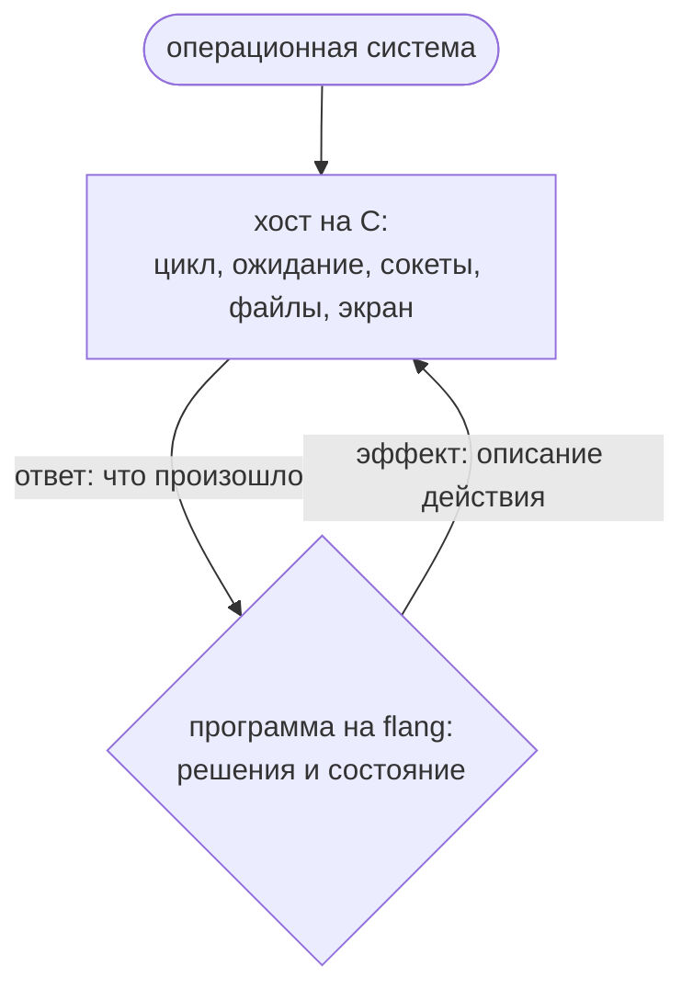

# Граница между flang и хостом

Что программа на flang может попросить у внешнего мира и чего не может. Страница
отвечает на этот вопрос двумя таблицами и двумя примерами, которые запускаются.

Два термина. **Хост** — программа на другом языке, обычно на C, которая ждёт
события и выполняет действия: читает файлы, открывает сокеты, пишет в регистры.
**Эффект** — описание одного такого действия. Функция на flang возвращает эффект
обычным значением, а выполняет его хост.



Функция на flang ничего не ждёт и ничего не меняет. Она получает состояние и
событие и возвращает новое состояние и эффект. Поэтому её можно проверять
примерами без файлов и сети и доказывать её постусловия.

## Пример: записать файл

Файл `docs/examples/host-boundary/note.flang`:

```flang insert docs/examples/host-boundary/note.flang
модуль «Note»

тип «Шаг заметки»
  вариант «Пишем»
  вариант «Ждём запись»

план «Заметка»
  состояние «Шаг заметки»
  начинает с «Начало заметки»
  обрабатывает «Дальше»

тотальная функция «Начало заметки»
  возвращает «Шаг заметки»
  вариант «Пишем»

тотальная функция «Записать заметку»
  возвращает «Поручение»
  вариант «Записать файл» с путь равным "note.txt" и содержимое равным "привет\n"

тотальная функция «Дальше»
  принимает шаг: «Шаг заметки», отклик: «Отклик»
  возвращает «Продолжение»
  пример «ошибка хоста становится ошибкой плана»
    дано шаг равно вариант «Ждём запись»
    дано отклик равно вариант «Сбой» с код равным "FLANG_IO_DENIED" и сообщение равным "запись запрещена"
    ожидается вариант «Провал» с код равным "FLANG_IO_DENIED" и сообщение равным "запись запрещена"
  разбор отклик
    случай вариант «Пока ничего»
      то вариант «Сделать» с поручение равным «Записать заметку» и потом равным (вариант «Ждём запись»)
    случай вариант «Записано»
      то вариант «Конец работы» с значение равным "записано"
    случай вариант «Сбой» с код как код и сообщение как сообщение
      то вариант «Провал» с код равным код и сообщение равным сообщение
    случай любое
      то вариант «Провал» с код равным "FLANG_IO_ORDER" и сообщение равным "ждали ответа на запись"
```

Здесь `план` объявляет программу с эффектами: тип состояния, начальную функцию и
функцию-обработчик. Типы `«Поручение»` (эффект), `«Отклик»` (ответ хоста) и
`«Продолжение»` (что делать дальше) встроены в язык. Хостом служит команда
`flang io`:

```text
$ flang io docs/examples/host-boundary/note.flang
доказано: утверждений 0
{"plan":"Заметка","result":"записано","orders":1,"log":[{"поручение":{"variant":"Записать файл",
"fields":{"путь":"note.txt","содержимое":"привет\n"}},"отклик":{"variant":"Записано","fields":{"сколько":7}}}]}
```

Строка «доказано: утверждений 0»: недоказанных постусловий в файле нет. За ней
ответ в JSON:
`result` — итог плана, `orders` — число выполненных эффектов, `log` — журнал.
В журнале одна пара: эффект «Записать файл» (ключ `поручение`) и ответ хоста
«Записано», 7 байтов (ключ `отклик`). Файл `note.txt` появился рядом с
`note.flang`: относительный путь считается от каталога программы.

План с недоказанными постусловиями `flang io` не выполняет, пока не дан ключ
`--trust`.

## Что программа может попросить

Эффектов 28, и список закрыт: добавить свой эффект из программы нельзя. Каждую
группу хост может запретить ключом `flang io`.

| Группа | Эффекты (имена вариантов типа `«Поручение»`) | Запрещает ключ |
| --- | --- | --- |
| чтение файлов | `Прочитать файл`, `Прочитать октеты из файла`, `Перечислить каталог` | `--no-read` |
| запись файлов | `Записать файл`, `Записать октеты в файл`, `Удалить файл`, `Завести временный каталог` | `--no-write` |
| сеть | `Запросить` (HTTP и HTTPS), `Открыть соединение`, `Принять соединение`, `Прочитать из соединения`, `Ответить в соединение`, `Прочитать октеты из соединения`, `Ответить октетами в соединение`, `Отправить датаграмму`, `Принять датаграмму` | `--no-net` |
| процессы | `Запустить процесс`, `Запустить процесс с вводом`, `Запустить процесс с пределом` | `--no-spawn` |
| время | `Текущее время` | `--no-clock` |
| случайные числа | `Случайное число`, `Случайные октеты` | `--no-random` |
| переменные среды | `Прочитать переменную среды` | `--no-env` |
| аргументы командной строки | `Прочитать доводы` | `--no-args` |
| экран и клавиатура | `Показать`, `Показать страницу`, `Ждать событие`, `Размер экрана` | `--no-screen` |

Запрещённый эффект не выполняется, и план останавливается с ошибкой
`FLANG_IO_DENIED`:

```text
$ flang io docs/examples/host-boundary/note.flang --no-write
доказано: утверждений 0
{"error":"хозяину запрещено писать файлы","diagnostics":[{"code":"FLANG_IO_DENIED",
"message":"хозяину запрещено писать файлы","severity":"error","span":{"line":7,"column":1}}]}
```

Строка с `FLANG_IO_DENIED` — ошибка: хосту (в сообщении он назван «хозяин»)
запрещено писать файлы. Код возврата 1. Ошибка эффекта без запрета приходит в обработчик
вариантом `«Сбой»`: исключений в языке нет.

## Чего программа не может

| Нельзя | Почему | Кто это делает |
| --- | --- | --- |
| ждать: `accept`, `poll`, чтение сокета, приход прерывания | в языке нет действия, которое блокирует выполнение | хост ждёт и передаёт результат аргументом |
| держать цикл событий | функция возвращает значение и заканчивается | цикл пишется в хосте |
| обратиться к адресу, регистру, памяти устройства | указателей и ручного выделения памяти нет | функция возвращает список записей в регистры, пишет хост |
| вставить ассемблер | такой формы в языке нет | хост |
| вызвать функцию чужой библиотеки или системный вызов | список эффектов закрыт | хост |
| изменить значение на месте | значения неизменяемы | состояние между вызовами хранит хост или `план` |

Из таблицы следует ответ про операционную систему. Целиком на flang она не
пишется: обработчик прерывания, переключение контекста и цикл ожидания остаются
на C. На flang пишется решающая часть: разбор пакетов и форматов, проверка прав,
состояния протоколов, политика планировщика, автомат драйвера.

> **Чего flang при этом не гарантирует.** Компилятор не доказан целиком, как
> CompCert. Доказательства относятся к программе на flang. Сгенерированный C
> можно сравнить с эталоном по каждой функции. Рантайм на C, компилятор C и
> libc принимаются без доказательства. Подробно —
> [Известные ограничения](limits.html).

## Пример: свой хост на C

Второй способ соединить две стороны — сгенерировать C и написать хост руками.
Каталог `docs/examples/host-boundary/`:

| Файл | Что в нём |
| --- | --- |
| `gatekeeper.flang` | решение: кого пропустить, кого отклонить и с каким кодом; восемь функций |
| `host.c` | хост: цикл, чтение стандартного ввода, изменяемое состояние |
| `run.sh` | генерация C, сборка и запуск одной командой |

Хост читает строку, строит событие и вызывает одну функцию модуля:

```c
for (;;) {
  if (fgets(line, sizeof line, stdin) == NULL) break;  /* событий больше нет */
  ...
  gatekeeper_enter(&ctx, "Шаг привратника", args, 2, &decision, &error);
  ...
}
```

Цикл написан на C из-за строки с `fgets`: она ждёт ввода.

Сгенерированный заголовок даёт две функции вызова. Значения, пришедшие извне,
передавайте через `gatekeeper_enter`:

```c
/* типы аргументов не проверяются */
fl_status gatekeeper_call (fl_ctx *ctx, const char *name, ...);
/* объявленные типы и предусловия проверяются до вызова */
fl_status gatekeeper_enter(fl_ctx *ctx, const char *name, ...);
```

Доказательство завершения опирается на тип аргумента. Значение вне типа лишает
это доказательство силы, поэтому вход извне проверяется.

Сначала проверьте решение:

```text
$ flang test docs/examples/host-boundary/gatekeeper.flang
docs/examples/host-boundary/gatekeeper.flang: примеров 15, прошло 15, не прошло 0
$ flang check docs/examples/host-boundary/gatekeeper.flang --proof
…
docs/examples/host-boundary/gatekeeper.flang: НЕ ДОКАЗАНО — ОПОРА НЕ СУДИЛАСЬ — утверждений 31: доказано 25, условно 0, сетка 6, … — код возврата 3
```

Все 15 примеров проходят. Из 31 постусловия 25 доказаны для любого входа, 6
проверены только на примерах (в выводе это слово «сетка»). Поэтому
`check --proof` возвращает код 3.

Затем соберите и запустите:

```text
$ flang emit docs/examples/host-boundary/gatekeeper.flang --target c --no-cli --out out
$ cc -std=c99 -Wall -Wextra -O2 -I out -o host docs/examples/host-boundary/host.c out/gatekeeper.c out/flang_runtime.c -lm -lpthread
$ printf 'запрос 1\nтакт\nтакт\nтакт\nзапрос 1\nзапрос 5\n' | ./host
хозяин: врата открыты. ёмкость 3, уровень ключа 2, запас 0
хозяин: жду событий на стандартном вводе: «такт» или «запрос N»
запрос 1 → код 429, ОТКАЗАНО, запас 0, пропущено 0, отказано 1
такт     → запас 1 из 3
такт     → запас 2 из 3
такт     → запас 3 из 3
запрос 1 → код 200, пропущен, запас 2, пропущено 1, отказано 1
запрос 5 → код 403, ОТКАЗАНО, запас 2, пропущено 1, отказано 2
хозяин: событий 6, пропущено 1, отказано 2
хозяин: нарочно порчу довод — запас 4 при ёмкости 3
граница отвергла довод: FLANG_PRECONDITION — не выполнено требование «запас не выше ёмкости» функции «Шаг привратника»
```

Слово «хозяин» в выводе — хост. Первые две строки он пишет при старте. Дальше
по строке на событие: первый запрос отклонён с кодом 429, потому что запас
пуст. Три события «такт» пополняют запас до 3. Следующий запрос проходит с
кодом 200. Запрос уровня 5 отклонён с кодом 403: не хватает прав. Девятая
строка — счётчики хоста.

В двух последних строках хост передаёт неверный аргумент («довод» в выводе):
запас 4 при ёмкости 3. Функция `gatekeeper_enter` проверяет предусловие и
возвращает ошибку `FLANG_PRECONDITION`. Программа при этом не падает, код
возврата 0.

Ключ `--no-cli` убирает из сгенерированного кода функцию `main`: она есть в
`host.c`. Память, которую занял вызов, хост освобождает на каждом шаге цикла
одним вызовом `fl_arena_reset`.

## Дальше

* [Известные ограничения](limits.html)
* [Процессы, надзор, распределённость](processes.html)
* [Драйвер MSI](msi-driver.html)
